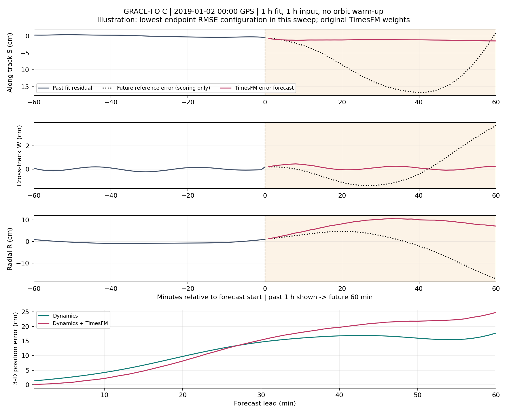

# 低轨卫星精密轨道预报 Demo

用 GRACE-FO C 精密轨道，比较**纯动力学**与**动力学＋TimesFM 误差修正**。动力学用截至起报点的历史观测拟合，TimesFM 用该弧段的历史残差预测下一小时误差，再加回动力学轨道。模型使用原始 TimesFM 3.0 权重。

## 预报精度

2019 年 1 月 2 日 00–07 时 GPS 每小时起报一次。各组合使用相同的 8 个窗口，拟合用 10 秒采样，模型输入和评分按分钟采样。所有拟合截至起报点，随后直接预测 60 分钟。

**第 60 分钟三维 RMSE（cm）**取八个窗口在最后一分钟的误差计算均方根。

| 动力学拟合 | 纯动力学 | TimesFM 1 h | 2 h | 4 h | 6 h | 8 h |
|---|---:|---:|---:|---:|---:|---:|
| 1 h | 108.28 | 106.15 | — | — | — | — |
| 2 h | 10.68 | 11.09 | 10.91 | — | — | — |
| 4 h | 25.03 | 26.31 | 19.95 | 23.38 | — | — |
| 6 h | 19.94 | 23.19 | 21.34 | 18.35 | 19.94 | — |
| 8 h | 16.84 | 22.17 | 16.96 | 17.30 | 16.24 | 16.27 |
| 12 h | 26.51 | 36.70 | 26.51 | 27.45 | 26.32 | 25.64 |
| 24 h | 34.80 | 53.09 | 45.70 | 34.57 | 34.76 | 35.03 |

**整段三维 RMS（cm）**用八个窗口的全部 480 个未来时刻计算。行表示动力学拟合时长，TimesFM 列表示模型可看到的残差时长。破折号表示输入超出拟合历史。

| 动力学拟合 | 纯动力学 | TimesFM 1 h | 2 h | 4 h | 6 h | 8 h |
|---|---:|---:|---:|---:|---:|---:|
| 1 h | 50.67 | 48.55 | — | — | — | — |
| 2 h | 7.37 | 5.97 | 6.39 | — | — | — |
| 4 h | 18.60 | 14.97 | 14.01 | 15.30 | — | — |
| 6 h | 18.39 | 13.64 | 14.10 | 12.82 | 14.57 | — |
| 8 h | 15.27 | 13.69 | 11.29 | 11.09 | 10.84 | 11.11 |
| 12 h | 19.34 | 22.94 | 16.06 | 16.66 | 15.96 | 15.51 |
| 24 h | 24.50 | 30.82 | 25.54 | 20.48 | 20.79 | 20.46 |

**1 h 与 2 h 拟合对照。** 纯动力学的末端 RMSE 分别为 108.28 cm 和 10.68 cm。固定 TimesFM 输入为 1 h，结果分别为 106.15 cm 和 11.09 cm。1 h 短于卫星约 95 分钟的轨道周期，两个窗口的阻力尺度估计接近求解下限。这提示短弧段上的参数估计可能影响外推精度。

2 h 拟合配合 1 h TimesFM 输入，整段 RMS 从 7.37 cm 降至 5.97 cm。上表对比基于同一组八个相互重叠的窗口，最优值属于这段数据的探索结果。

[汇总精度](reference/summary.csv) · [逐窗口误差](reference/by_window.csv) · [逐分钟 RMSE](reference/by_lead.csv) · [运行环境](reference/environment.json)



图示为 1 h 拟合、1 h TimesFM 输入的首个窗口。灰线为历史拟合残差，红线为 TimesFM 预测，黑点线为未来参考误差。底部显示加入修正前后的三维位置误差。

## 运行

安装 Git 和 Python 3.11 或 3.12。

```bash
git clone https://github.com/Xsleet/leo-precise-orbit-demo.git
cd leo-precise-orbit-demo
python -m venv .venv
```

Windows 命令提示符运行 `.venv\Scripts\activate.bat`。Linux/macOS 运行 `source .venv/bin/activate`。PowerShell 可用 `.\.venv\Scripts\python.exe` 代替下面的 `python`。

**CPU**

```bash
python -m pip install torch==2.8.0 --index-url https://download.pytorch.org/whl/cpu
python -m pip install -r requirements-timesfm.txt
python window_sweep.py --device cpu
```

macOS 用 `python -m pip install torch==2.8.0` 安装 PyTorch。

**GPU（NVIDIA，驱动需支持 CUDA 12.8）**

```bash
python -m pip install torch==2.8.0 --index-url https://download.pytorch.org/whl/cu128
python -m pip install -r requirements-timesfm.txt
python window_sweep.py --device gpu
```

默认比较表中所有长度。首次运行自动下载约 1.32 GB 模型权重。GPU 加速 TimesFM，动力学拟合使用 CPU。仓库附带校验匹配的动力学缓存，可加 `--refit` 重算。

只比较 1 h 和 2 h 拟合，统一用 1 h 输入：

```bash
python window_sweep.py --device gpu --fit-hours 1 2 --context-hours 1 --output outputs/compare-1h-2h
python plot_windows.py --folder outputs/compare-1h-2h
```

将 `--device gpu` 改为 `--device cpu` 即可用 CPU 跑同一实验。只算动力学时，安装 `requirements.txt` 并运行 `python window_sweep.py --model physics --device cpu`。

结果写入 `outputs/`，包含汇总、逐窗口与逐分钟评分、预测坐标及拟合参数。可由 [基础知识](BASICS.md) 入门，再阅读 [no_warmup.py](no_warmup.py) 中的 `prepare()` 和 `correct()`。评分使用事后发布的精密轨道，数据与力模型说明见 [DATA_SOURCES.md](DATA_SOURCES.md) 和 [DYNAMICS.md](DYNAMICS.md)。运行 `python -m unittest discover -v` 检查数据、结果和动力学。

自编代码采用 MIT 许可。数据及模型遵循各自许可。TimesFM 3.0 用于其许可允许的非商业、非生产教学研究，见 [模型许可](https://huggingface.co/google/timesfm-3.0-pytorch/blob/main/LICENSE)。

同系列：[精密钟差预报](https://github.com/Xsleet/gracefo-clock-prediction) · [空间碎片轨道预测](https://github.com/Xsleet/space-debris-orbit-demo)
