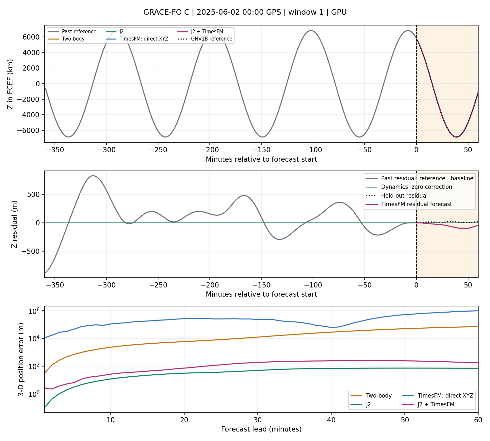
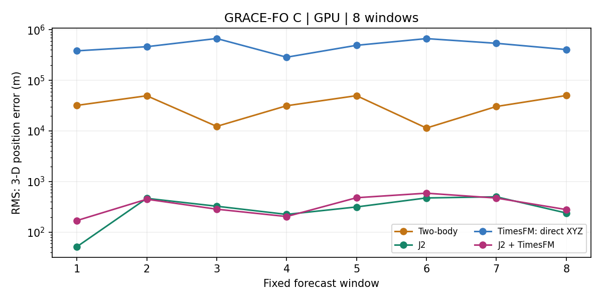

# 低轨卫星精密轨道预测 Demo

用 **GRACE-FO C 星的真实 GNV1B 精密轨道产品**，演示动力学与时间序列模型的结合。

**过去 6 小时 → 起报虚线 → 未来 60 分钟**，新增 **动力学＋TimesFM 误差预报**，保留 CPU/GPU。

## 1. 先理解这三步

1. 从起报点**已知的位置和速度**出发，用 J2 回算过去 6 小时，并外推未来 60 分钟。
2. 计算 `历史误差 = GNV1B 历史位置 - J2 回算位置`，用原始 TimesFM 预报未来误差。
3. `补偿预测 = J2 的未来位置 + TimesFM 预测误差`。

另外比较 **二体、J2、TimesFM 直接预测 XYZ**，共四种方法。J2 回算和预报属于同一条轨道，起报点不更换基线；回算只使用起报前已知状态，未来 GNV1B 只用于评分。

**“精密”指参考轨道产品与任务，不表示已实现厘米级预报。** 这是后处理精密轨道产品的离线回放，没有模拟产品发布延迟。

先读约 130 行的 [main.py](main.py)，核心是 `predict()`；画图单独放在 [plotting.py](plotting.py)，动力学在 [orbit.py](orbit.py)。**两个 TimesFM 分支使用同一个官方原始模型，没有微调。**

## 2. 下载与运行

安装 Python **3.11 或 3.12** 和 Git：

```bash
git clone https://github.com/Xsleet/leo-precise-orbit-demo.git
cd leo-precise-orbit-demo
python -m venv .venv
```

Windows 命令提示符：`.venv\Scripts\activate.bat`；Linux/macOS：`source .venv/bin/activate`。PowerShell 可将下文 `python` 换为 `.\.venv\Scripts\python.exe`。

**CPU：**

```bash
python -m pip install torch==2.8.0 --index-url https://download.pytorch.org/whl/cpu
python -m pip install -r requirements-timesfm.txt
python main.py --device cpu
```

**GPU：NVIDIA 显卡，驱动支持 CUDA 12.8。**

```bash
python -m pip install torch==2.8.0 --index-url https://download.pytorch.org/whl/cu128
python -m pip install -r requirements-timesfm.txt
python main.py --device gpu
```

CPU/GPU 只改变 TimesFM 推理设备，动力学仍在 CPU。首次自动下载约 **1.32 GB** 模型，不需要训练；正常运行使用附带数据，无需轨道数据网站登录或服务器。macOS 将 CPU 安装首条命令换为 `python -m pip install torch==2.8.0`。[PyTorch 官方安装说明](https://pytorch.org/get-started/previous-versions/#v280)。

只跑动力学、不下载模型：`python -m pip install -r requirements.txt`，然后 `python main.py --model physics`。

## 3. 看懂结果



- 上图：Z 坐标的过去轨迹与未来预测。
- 中图：**去除动力学轨道后的 Z 误差 → 起报虚线 → 未来误差预报**；零线代表不补偿。黑色点线仅用于事后评分。
- 下图：全部 XYZ 的三维误差，使用对数纵轴；不能只凭 Z 曲线是否重合判断精度。

起报点 J2 由已知状态初始化，所以历史误差末点为零；未来误差仍可能增长。

**全部 8 个固定窗口合并的三维 RMS（m）**，相对 GNV1B 精密轨道：

| 方法 | CPU | GPU |
|---|---:|---:|
| 二体 | 36,568.996 | 36,568.996 |
| J2 | 355.724 | 355.724 |
| TimesFM 直接预测 XYZ | 504,960.215 | 504,960.012 |
| **J2＋TimesFM 误差预报** | 392.956 | 392.956 |

补偿相比直接 XYZ 预测大幅改善；相对 J2，**4/8 个窗口变好，合并 RMS 反而变差**（约 393 m 对 356 m）。原始 TimesFM 没有针对轨道误差训练，因此不保证补偿有效。这里保留全部窗口，不挑选最好看的结果。



`outputs/timesfm-cpu/window-01/` 中：`result.png` 是图，`history.csv` 保存历史参考、动力学与误差，`prediction.csv` 保存未来参考及各方法预测，`metrics.csv` 保存 RMS/60 分钟误差，`run.json` 保存方法和窗口说明。GPU 对应 `timesfm-gpu`。

```text
三维误差 = sqrt(dx² + dy² + dz²)
RMS(3D) = sqrt(全部未来点的三维误差平方的平均值)
```

## 4. 换窗口与自主分析

8 个固定起报时刻为 **2025 年 6 月 2–3 日每天 00、06、12、18 时（GPS）**，与上一版一致。GPS 时间不是 UTC。

```bash
python main.py --device cpu --window 3
python compare_windows.py --device cpu
python compare_windows.py --device gpu
```

每个窗口取 360 点（-359 至 0 分钟），预测 +1 至 +60 分钟；间隔 60 s。批处理只加载一次模型，保存所有窗口及 `by_window.csv`、`summary.csv`、`comparison.png`。也支持 `--model physics`。

给学生的三个问题：补偿在哪些窗口有效？为何直接预测 XYZ 比预测误差困难？为什么去掉大幅周期轨道后，剩余误差仍不好预测？

数据来源、坐标、时间假设和限制见 [DATA_SOURCES.md](DATA_SOURCES.md)；完整 CPU/GPU 实测结果见 [reference](reference/README.md)。`python -m unittest discover -v` 检查时间边界、误差加回、J2 正反向积分和归档指标。CI 检查 Windows/Linux、Python 3.11/3.12 的基础流程，不在线下载大模型。

自编代码为 MIT；数据和模型遵循各自许可。TimesFM 3.0 权重用于非商业、非生产教学研究，仓库不分发权重，见 [模型许可](https://huggingface.co/google/timesfm-3.0-pytorch/blob/main/LICENSE)。

同系列：[精密钟差预报](https://github.com/Xsleet/gracefo-clock-prediction) · [空间碎片轨道预测](https://github.com/Xsleet/space-debris-orbit-demo)
