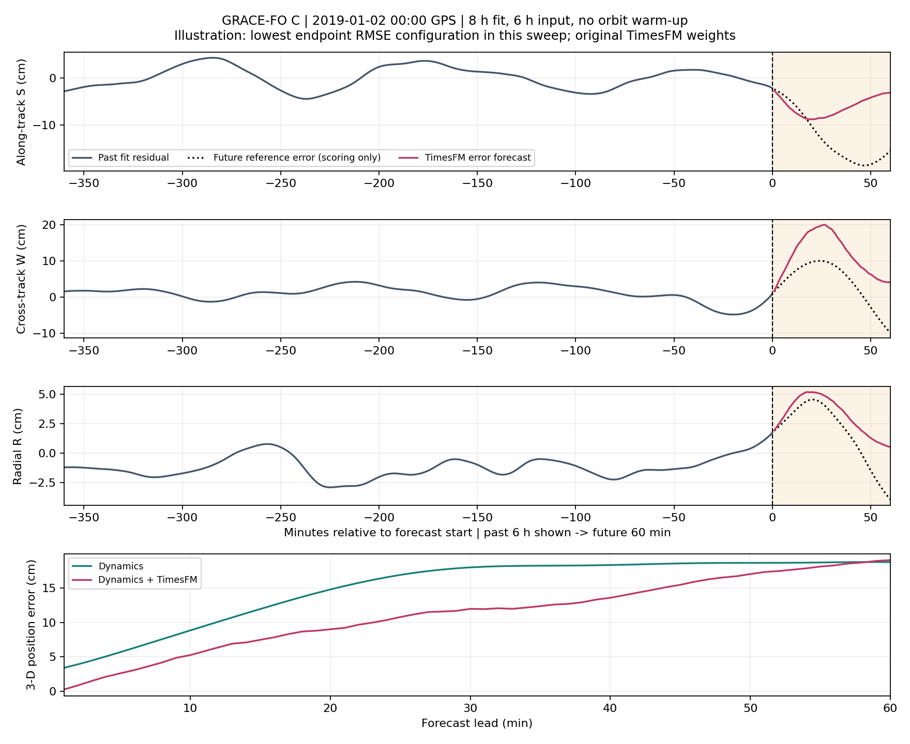

# 低轨卫星精密轨道预报 Demo

用 GRACE-FO C 的真实精密轨道，演示 **动力学预报 + TimesFM 误差预报**。
最新实验采用：**用截至起报点的历史拟合动力学 → TimesFM 预测历史残差 → 修正未来 60 分钟轨道**。

当前动力学已升级为 Orekit：150 阶 EGM2008、DE405 日月引力、潮汐、物理阻力、太阳辐射压和精密坐标变换。
TimesFM 使用原始 3.0 权重，没有微调。

**当前入口是无预热的窗口长度实验：** 2019 年 1 月 2 日 00–07 时，每小时起报，共八个窗口。
比较 **8/12/24 h 动力学拟合 × 1/2/4/6/8 h TimesFM 输入**，同时实测 CPU/GPU 速度。
完整成绩见 **[RESULTS_WINDOWS.md](RESULTS_WINDOWS.md)**。这是一组短期探索实验，最优组合尚未在独立时段验证。

## 1. 先看懂三个步骤

1. 用过去的位置，拟合初始位置/速度、经验加速度和每圈阻力尺度。
2. 用同一条拟合轨道与历史参考位置作差，交给 TimesFM 预测未来误差。
3. **最终预报 = 动力学未来位置 + TimesFM 预测的未来误差**。

例如 10:00 起报：8 h 拟合用 02:00–10:00；6 h 模型输入取最近 360 个分钟残差；预测 10:01–11:00。
**拟合长度**决定用多少历史估计动力学参数；**输入长度**决定 TimesFM 看多少历史误差。两者可以不同。
动力学以 10 s 观测拟合，残差按 60 s 采样；三个方向分别预测。未来参考轨道只用于最后评分。
这里没有预留 20 min 轨道预热段，输入均是拟合残差，它与未来外推误差的性质可能不同。
先读 [基础知识](BASICS.md)，再读 [no_warmup.py](no_warmup.py) 的 `prepare()` 和 `correct()`；底层力模型在 [precise.py](precise.py)。
与论文的逐项配置差异见 [DYNAMICS.md](DYNAMICS.md)：大气模型采用 DTM2000 替代 DTM94，仍有名义姿态等简化。

## 2. 下载与运行

安装 Python 3.11 或 3.12 和 Git：

```bash
git clone https://github.com/Xsleet/leo-precise-orbit-demo.git
cd leo-precise-orbit-demo
python -m venv .venv
```

Windows 命令提示符执行 `.venv\Scripts\activate.bat`；Linux/macOS 执行 `source .venv/bin/activate`。
PowerShell 可把下文 `python` 换成 `.\.venv\Scripts\python.exe`。

**CPU：**

```bash
python -m pip install torch==2.8.0 --index-url https://download.pytorch.org/whl/cpu
python -m pip install -r requirements-timesfm.txt
python window_sweep.py --device cpu
```

**GPU：NVIDIA 显卡，驱动支持 CUDA 12.8。**

```bash
python -m pip install torch==2.8.0 --index-url https://download.pytorch.org/whl/cu128
python -m pip install -r requirements-timesfm.txt
python window_sweep.py --device gpu
```

macOS 的 PyTorch 安装命令改为 `python -m pip install torch==2.8.0`，运行时选 `cpu`。
首次自动下载约 1.32 GB TimesFM 权重；Java 运行时由依赖包安装，无需手动配置。

**默认复用附带的动力学计算结果，再实际运行 TimesFM。** 缓存与历史数据、源码、力模型和依赖版本校验匹配。
研究拟合过程时加 `--refit` 从头计算，耗时明显更长。GPU 只加速 TimesFM，动力学使用 CPU。
TimesFM 默认使用 4 个 CPU 线程，可用 `--threads` 修改；`--workers` 控制动力学的并行进程数，两者不同。

不下载 TimesFM，只看三种拟合长度的动力学对照：

```bash
python -m pip install -r requirements.txt
python window_sweep.py --model physics --device cpu
```

## 3. 看懂结果



前三行是沿轨、法向、径向误差：**过去 6 小时 → 起报虚线 → 未来 60 分钟**。
灰线是过去的拟合残差，红线是 TimesFM 预测的误差，黑色点线是事后参考误差；最下面比较修正前后的三维位置误差。
图例展示本次末端 RMSE 最小的组合和固定第一个窗口，不代替全部窗口的统计。

每种拟合长度都有自己的纯动力学对照，TimesFM 只改正该轨道的误差。
“60 min RMSE”是八个窗口在第 60 分钟的三维距离均方根；“整段 RMS”把全部八个窗口、每个窗口 60 个时刻一起计算。
窗口重叠、时段短，不能凭最优单格成绩断言长期有效。

## 4. 自己分析

```bash
python window_sweep.py --device cpu --fit-hours 8 --context-hours 6
python window_sweep.py --model physics --device cpu --refit --workers 4
python benchmark_timesfm.py --device cpu
python benchmark_timesfm.py --device gpu
```

第一条只跑一个组合；第二条从头拟合全部轨道；最后两条用相同八个窗口测速。
测速应依次执行，并等动力学或其他重任务结束。每种输入长度先作计算预热，再测三轮，报告中位数；这与轨道的 20 min 预热不是同一件事。
已有模型时加 `--checkpoint 模型目录`。窗口成绩写入 `outputs/window-sweep-timesfm-cpu/` 或对应 GPU 目录。
运行全部组合后可用 `python plot_windows.py` 绘图；CPU 结果加 `--folder outputs/window-sweep-timesfm-cpu`。

旧的含 20 min 轨道预热实验保留，便于对照：

```bash
python short_2019.py --device cpu
python main.py --device cpu --window 3
```

2019 含预热的结果见 [RESULTS_2019.md](RESULTS_2019.md)，2025 结果见 [RESULTS.md](RESULTS.md)。
新版与旧版同时改变了预热安排及输入长度，应按各自配置解读。

新版的主要输出：

| 文件 | 用途 |
|---|---|
| prediction.csv / baseline.csv | 所有组合的未来参考和预测坐标 |
| fit-08h-window-01/history.npz | 历史位置、拟合轨道及残差 |
| fit-08h-window-01/fit.json | 拟合参数与时间边界 |
| environment.json | 软件版本、配置、源码及数据哈希 |
| summary.csv / by_window.csv | 整体与逐窗口成绩 |
| by_lead.csv | 1–60 min 各时刻的跨窗口 RMSE |

当前归档在 [reference/window-sweep](reference/window-sweep/README.md)，含 GPU 完整精度结果、CPU/GPU 测速、动力学缓存及运行源码。
旧结果分别保存在 [2019-short](reference/2019-short/README.md)、[precise](reference/precise/README.md)、[li2025](reference/li2025/README.md)。
运行 `python -m unittest discover -v` 检查力模型数据、时标、潮汐相位、历史边界与归档结果。

给学生的三个问题：历史越长是否一定越好？拟合残差与未来外推误差有什么区别？为什么 GPU 加速模型却不一定明显缩短整个实验？

这是后处理精密产品的离线回放，未模拟产品发布延迟。数据、力模型差异与辅助量可用性见 [DYNAMICS.md](DYNAMICS.md)、[DATA_SOURCES.md](DATA_SOURCES.md)，实验记录见 [EXPERIMENT.md](EXPERIMENT.md)。
自编代码 MIT；数据及模型遵循各自许可。TimesFM 3.0 用于其许可允许的非商业、非生产教学研究，见 [模型许可](https://huggingface.co/google/timesfm-3.0-pytorch/blob/main/LICENSE)。

同系列：[精密钟差预报](https://github.com/Xsleet/gracefo-clock-prediction) · [空间碎片轨道预测](https://github.com/Xsleet/space-debris-orbit-demo)
