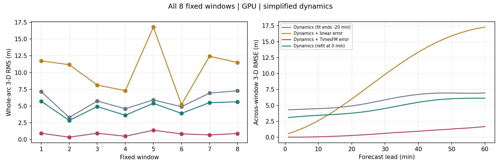

# Li（2025）思路实验结果

2026-11-16 实测，CPU/GPU 各运行全部 8 个固定窗口。TimesFM 没有微调。
原始结果见 [CPU](reference/li2025/cpu/summary.csv)、[GPU](reference/li2025/gpu/summary.csv)。

## 主要结果

| 方法 | CPU 整段 RMS（m） | GPU 整段 RMS（m） | GPU 60 min RMSE（m） |
|---|---:|---:|---:|
| 动力学（拟合至起报前 20 min） | 5.871 | 5.871 | 6.958 |
| 动力学＋线性误差 | 11.050 | 11.050 | 17.274 |
| 动力学＋TimesFM 误差 | 0.858 | 0.858 | 1.674 |
| 动力学（用最新历史重新拟合） | 4.798 | 4.798 | 6.131 |

整段 RMS 对 8×60 个未来点合并计算；60 min RMSE 只使用每个窗口的第 60 分钟，再跨 8 个窗口平方平均开方。
不能混用两个指标，也不能用终点距离的算术平均代替 RMSE。

TimesFM 相对同一条动力学轨道，整段 RMS 降低 **85.4%**，60 min RMSE 降低 **75.9%**。
整段改善 **8/8** 窗口，终点改善 **8/8** 窗口。
相对“最新历史重新拟合动力学”，整段 RMS 降低 **82.1%**，改善 **8/8** 窗口。

## 与 Li 等（2025）Table 5 对照

均列出相应预报时刻的三维 RMSE，全部换算为米。论文基线使用 Table 5 同一测试集的 **14.7 cm**，不混用摘要的全年 RDOP 14.0 cm。

| 预报时长 | 本例动力学（m） | 本例＋TimesFM（m） | 论文 RDOP（m） | 论文＋GRU（m） |
|---|---:|---:|---:|---:|
| 10 min | 4.487 | 0.073 | 0.030 | 0.010 |
| 20 min | 4.919 | 0.277 | 0.049 | 0.019 |
| 30 min | 5.867 | 0.618 | 0.073 | 0.029 |
| 60 min | 6.958 | 1.674 | 0.147 | 0.060 |

论文 60 min 的 0.147 → 0.060 m，对应降低约 **59.2%**（按论文原表）。
本例有效降低了自身动力学误差，但尚未达到论文的厘米级精度。
相对降幅更大也不能证明 TimesFM 胜过论文模型，因为基线难度和数据条件不同。

| 条件 | 本例 | Li 等（2025） |
|---|---|---|
| 参考数据 | GRACE-FO C，2025 年 6 月，8 个固定预报窗口 | GRACE-FO，2019 全年 |
| 历史拟合/预热 | 8 h / 20 min | 最优配置 8 h / 20 min |
| 地球重力场 | EGM2008 120 阶/次 | EGM2008 150 阶 |
| 其他动力学 | 5 个经验加速度系数、匀速地球自转 | 日月引力、潮汐、DTM94 阻力、太阳辐射压等 |
| 学习模型 | 原始 TimesFM 3.0，零样本，无微调 | 专门训练的 GRU Seq2Seq |
| 模型输入 | S/W/R 历史误差 | 位置、速度、拟合残差、预热误差等 |
| 数据可用性 | 后处理产品按历元回放 | 精密轨道产品实验 |

[论文 DOI](https://doi.org/10.1007/s00190-025-01999-7)。论文 PDF 不随仓库分发。

## 每个窗口都保留

| 窗口 | 动力学 RMS（m） | ＋TimesFM RMS（m） | 最新历史动力学 RMS（m） |
|---|---:|---:|---:|
| 1 | 7.162 | 0.920 | 5.717 |
| 2 | 3.283 | 0.342 | 2.842 |
| 3 | 5.743 | 0.929 | 4.912 |
| 4 | 4.589 | 0.481 | 3.617 |
| 5 | 5.912 | 1.377 | 5.396 |
| 6 | 4.887 | 0.833 | 3.900 |
| 7 | 6.925 | 0.687 | 5.497 |
| 8 | 7.267 | 0.881 | 5.629 |

## 初轮 J2 对照与数值验证

最初只使用 J2 + 经验加速度，首窗口历史拟合 RMS 约 208 m。补上 EGM2008 后降到约 1.23 m。
这反映了改善基础动力学的重要性；不能指望网络独自补偿全部未建模引力。
J2 轮次的全部结果与当时源码保存在 [reference/li2025/j2-gpu](reference/li2025/j2-gpu/summary.csv) 和 [源码快照](reference/li2025/j2-source)。
此次不是在多个重力场阶数中按测试误差挑选；直接使用公开附带的 120 阶模型，修改过程见 [EXPERIMENT.md](EXPERIMENT.md)。

- 球谐加速度与独立 Brahe 1.9.0 实现核对 101 个位置，最大分量差约 8.7e-14 m/s²；Brahe 仅用于验证，不是运行依赖。
- 调紧 DOP853 积分容差的敏感性为毫米量级，具体原始值见 [数值积分检查](reference/li2025/integration-validation.json)。这不是实际轨道精度。
- 测试覆盖独立势函数梯度、合成受力参数恢复、S/W/R 变换、预热隔离、三维 RMSE 公式和归档坐标重算。
