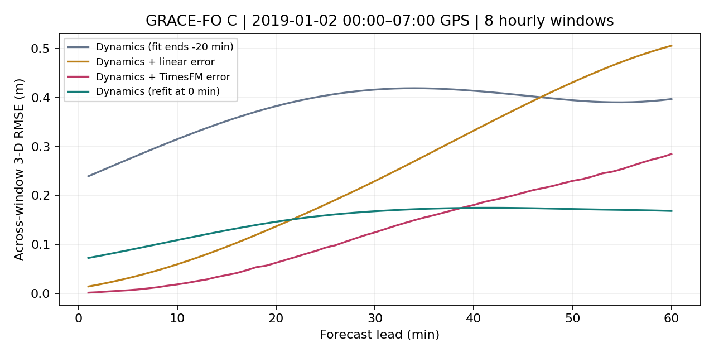

# 2019 短期实验结果

固定窗口：**2019-01-02 00:00–07:00 GPS，每小时一次，共 8 个；每次预测未来 60 min。**
GRACE-FO C、GNV1B RL04；10 s 采样拟合 8 h，20 min 预热；原始 TimesFM 3.0，无微调。
TimesFM 输入为 60 min 拟合残差 + 20 min 预热误差。全部窗口在评分前固定，没有挑选或替换。

**短期结论：最新重拟合的动力学基线达到 16.8 cm。TimesFM 改善了同一条预热弧段，但第 60 min 的 28.5 cm 仍高于最新重拟合；整段 RMS 也略高。**

## 汇总

| 方法 | 整段 60 min 三维 RMS (m) | 第 60 min 三维 RMSE (m) |
|---|---:|---:|
| 动力学（拟合截至前 20 min） | 0.3782 | 0.3970 |
| 动力学＋TimesFM（80 点历史） | 0.1564 | 0.2847 |
| 动力学（截至起报点重新拟合） | 0.1527 | 0.1684 |
| 动力学＋线性误差 | 0.2909 | 0.5060 |

相对同一动力学弧段，TimesFM 第 60 min 误差降低 **28.30%**，整段 RMS 降低 **58.64%**；负值表示变差。
整段 RMS 优于同弧段基线 7/8 窗口，优于最新重拟合 5/8；第 60 min 分别为 6/8 和 4/8。



## 基线与论文的关系

本例最新历史重拟合的 60 min 三维 RMSE 为 **16.84 cm**。同弧段列在拟合结束后还经历 20 min 预热，所以最后实际外推 80 min；不要把它直接当成论文的 60 min RDOP。
Li 等（2025）Table 4 的全年 60 min RDOP 为 **14.0 cm**；Table 5 测试集为 **14.7 cm → DNN-RDOP 6.0 cm**。
本例只覆盖一月八个小时，且不属于论文年末测试时段，不能把短期成绩当作全年或同测试集复现。
论文：[Deep neural network based precise orbit prediction for low earth orbit (LEO) satellites](https://doi.org/10.1007/s00190-025-01999-7)。

## 与旧 2025 实验对照

| 指标：第 60 min 三维 RMSE | 2025 旧实验 (m) | 2019 短期实验 (m) |
|---|---:|---:|
| 同弧段动力学 | 1.1439 | 0.3970 |
| ＋TimesFM | 0.7606 | 0.2847 |
| 最新历史重拟合 | 1.2744 | 0.1684 |

两次还存在动力学采样（60 s / 10 s）及模型历史长度（360 / 80 min）差异；不能把全部变化单独归因于年份或太阳活动。
力模型仍为 EGM2008 150 阶、DE405、固体潮/极潮、EOT11a 18 主分潮、DTM2000、名义姿态宏观辐射压、S/W 一次每圈经验项。
与论文的 DTM94、完整海潮等差异见 [DYNAMICS.md](DYNAMICS.md)。没有根据这八个未来窗口调参。

## 每个窗口都列出

下表是单个窗口第 60 min 的三维距离；上表汇总用均方根，不是算术平均。

| 起报时刻 GPS | 同弧段动力学 (m) | ＋TimesFM (m) | 最新重拟合 (m) |
|---|---:|---:|---:|
| 2019-01-02 00:00 | 0.3278 | 0.1529 | 0.1874 |
| 2019-01-02 01:00 | 0.1805 | 0.3001 | 0.1595 |
| 2019-01-02 02:00 | 0.9330 | 0.6776 | 0.0610 |
| 2019-01-02 03:00 | 0.4398 | 0.1815 | 0.2959 |
| 2019-01-02 04:00 | 0.1040 | 0.1015 | 0.0410 |
| 2019-01-02 05:00 | 0.1036 | 0.1387 | 0.2296 |
| 2019-01-02 06:00 | 0.0699 | 0.0467 | 0.1042 |
| 2019-01-02 07:00 | 0.1746 | 0.1046 | 0.0995 |

## 复现与检查

```bash
python short_2019.py --device cpu
python short_2019.py --device gpu
python short_2019.py --model physics --refit --workers 4
```

CPU/GPU 都已实际运行 TimesFM；两者共享实际在 CPU 上拟合、积分的动力学轨道。
CPU/GPU 预测坐标的最大三维差异为 0.000001661 m。
第 3 窗口在相同拟合参数下，将积分最大步长从 60 s 收紧至 30 s、位置容差从 1e-7 m 收紧至 1e-8 m，轨道最大变化约 1.93 mm。
这是积分敏感度检查，不等于实际轨道预报精度。
逐点位置、历史残差、拟合参数、CPU/GPU 结果、源码副本和哈希全部保存在 [reference/2019-short](reference/2019-short/README.md)。
八个窗口每小时滑动，历史彼此重叠，不应视为八个独立样本；本次仅为短期可行性验证。精密产品发布延迟和实时 EOP 误差未建模。
