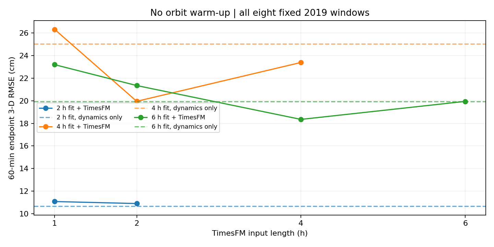

# 更短的动力学拟合时间

在 2019 年 1 月 2 日 00–07 时 GPS 的八个起报窗口上，新增 2、4、6 小时拟合，并引用此前的 8 小时结果。
使用同一份 GRACE-FO C 精密轨道、10 秒观测和力模型，拟合截止起报点，无轨道预热，预报未来 60 分钟。
TimesFM 使用原始权重，在 GPU 上预测拟合残差。模型输入最多取该拟合弧内的历史。

**2 小时拟合的纯动力学末端 RMSE 最低，为 10.68 cm，比 8 小时拟合的 16.84 cm 低约 37%。**
**在 2 小时拟合上，1 小时输入的 TimesFM 将整段 RMS 从 7.37 cm 降至 5.97 cm，末端 RMSE 则升至 11.09 cm。**
本次在同一组八个窗口上比较配置，最优值属于短期探索结果。

## 第 60 分钟三维 RMSE（cm）

| 动力学拟合 | 纯动力学 | TimesFM 1 h | 2 h | 4 h | 6 h | 8 h |
|---|---:|---:|---:|---:|---:|---:|
| 2 h | 10.68 | 11.09 | 10.91 | — | — | — |
| 4 h | 25.03 | 26.31 | 19.95 | 23.38 | — | — |
| 6 h | 19.94 | 23.19 | 21.34 | 18.35 | 19.94 | — |
| 8 h | 16.84 | 22.17 | 16.96 | 17.30 | 16.24 | 16.27 |

纯动力学列直接比较拟合时长。固定 1 h 或 2 h 输入也可逐行比较。表中破折号表示输入时长超过拟合时长。
2 h 相比 8 h 纯动力学，整段 RMS 在 7/8 个窗口更低，末端误差在 4/8 个窗口更低。

在新增的三种时长中，末端最好的 TimesFM 组合为 2 h 拟合、2 h 输入。相对同一条动力学轨道，末端 RMSE 从 10.68 cm 变为 10.91 cm，末端误差更小的窗口有 2/8 个。

## 整段 60 分钟三维 RMS（cm）

| 动力学拟合 | 纯动力学 | TimesFM 1 h | 2 h | 4 h | 6 h | 8 h |
|---|---:|---:|---:|---:|---:|---:|
| 2 h | 7.37 | 5.97 | 6.39 | — | — | — |
| 4 h | 18.60 | 14.97 | 14.01 | 15.30 | — | — |
| 6 h | 18.39 | 13.64 | 14.10 | 12.82 | 14.57 | — |
| 8 h | 15.27 | 13.69 | 11.29 | 11.09 | 10.84 | 11.11 |

2 h 拟合加 1 h TimesFM 输入的整段 RMS 最低，相对同一动力学基线降低约 19%，整段误差改善了 7/8 个窗口。



图中的虚线为各拟合长度的纯动力学对照。
第一个窗口的历史残差和未来预报见 [示例图](reference/short-fit/gpu/example.png)。

## 复现

```bash
python window_sweep.py --device gpu --fit-hours 2 4 6 --output outputs/short-fit-gpu
python plot_windows.py --folder outputs/short-fit-gpu
```

CPU 运行时用 `--device cpu` 并指定另一个输出目录。附带缓存可直接复用，也可增加 `--refit` 重新拟合。

逐点位置、历史残差、拟合参数和软件版本见 [补测归档](reference/short-fit/README.md)。
8 小时对照来自 [上一轮结果](RESULTS_WINDOWS.md)。
