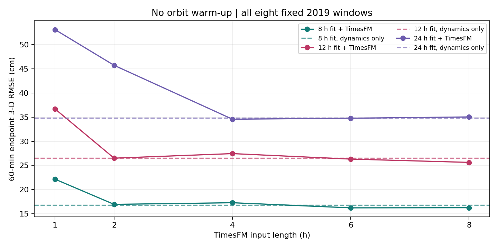
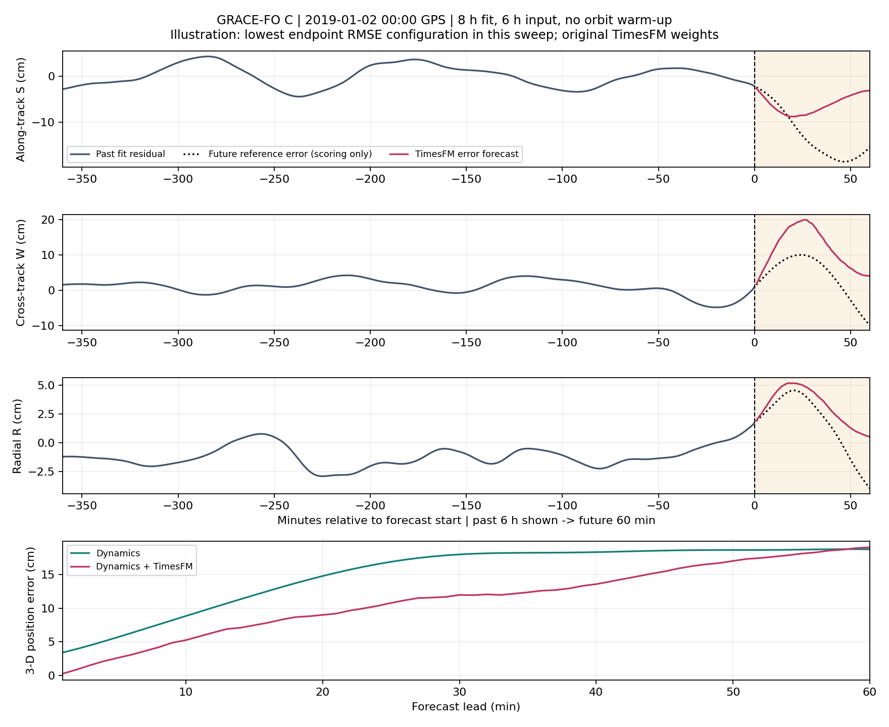

# 无预热：拟合长度、输入长度与 CPU/GPU 实测

相同八个窗口的 2、4、6 小时拟合结果见 [短拟合补测](RESULTS_SHORT_FIT.md)。

2019-01-02 00:00–07:00 GPS，八个固定起报点，每次预测未来 60 min；GRACE-FO C GNV1B RL04。
全部窗口保留。动力学配置沿用 2019 版本，10 s 观测拟合；误差按 60 s 采样，原始 TimesFM 3.0，无微调。

**本组末端成绩最好的组合是 8 h 拟合 + 6 h 输入：第 60 min 三维 RMSE 从 16.84 cm 变为 16.24 cm，变化对应误差降低 3.57%。**
这是在本组窗口上比较 15 个组合后的最小值，不是独立测试精度。

## 1. 输入加长是否更好？

表内是 **第 60 min 三维 RMSE，单位 cm，越小越好**。每一行都与该行的纯动力学比较。

| 动力学拟合 | 纯动力学 | 输入 1 h | 2 h | 4 h | 6 h | 8 h |
|---|---:|---:|---:|---:|---:|---:|
| 8 h | 16.84 | 22.17 | 16.96 | 17.30 | 16.24 | 16.27 |
| 12 h | 26.51 | 36.70 | 26.51 | 27.45 | 26.32 | 25.64 |
| 24 h | 34.80 | 53.09 | 45.70 | 34.57 | 34.76 | 35.03 |



下面是 **整段 60 min 三维 RMS，单位 cm**，同时包含八个窗口的全部 480 个预报时刻。

| 动力学拟合 | 纯动力学 | 输入 1 h | 2 h | 4 h | 6 h | 8 h |
|---|---:|---:|---:|---:|---:|---:|
| 8 h | 15.27 | 13.69 | 11.29 | 11.09 | 10.84 | 11.11 |
| 12 h | 19.34 | 22.94 | 16.06 | 16.66 | 15.96 | 15.51 |
| 24 h | 24.50 | 30.82 | 25.54 | 20.48 | 20.79 | 20.46 |

对上述 8 h + 6 h 组合，整段 RMS 改善 28.99%；末端改善 2/8 个窗口，整段改善 8/8 个窗口。
不能只看最好的单格或把末端成绩与整段成绩混在一起。完整逐窗口数值在归档中。

## 2. GPU 是否更快？

本机：Intel Core i7-14700KF（CPU 推理 4 线程）与 NVIDIA RTX 5070 Ti；两端均使用同一 CUDA 版 PyTorch 2.8.0 环境和相同权重，分别指定 cpu/cuda。
暂停后台动力学拟合后依次测速，测完恢复计算。每种输入长度先运行两次，测三轮取中位数；每轮为同样八个窗口、每个窗口三个方向、预测 60 点。
这里的计算预热只用于稳定测速，与轨道的 20 min 预热无关。CUDA 在计时前后同步。

| 模型输入 | CPU 八窗口 (s) | GPU 八窗口 (s) | CPU 耗时 / GPU 耗时 |
|---|---:|---:|---:|
| 1 h | 1.675 | 1.436 | 1.17× |
| 2 h | 1.720 | 1.529 | 1.12× |
| 4 h | 1.953 | 1.560 | 1.25× |
| 6 h | 2.125 | 1.714 | 1.24× |
| 8 h | 2.212 | 1.807 | 1.22× |

模型加载：CPU 1.407 s，GPU 1.709 s。加载后的第一次 8 h 输入推理：CPU 0.957 s，GPU 0.785 s。
加载时间不含模型下载、Python/Torch 导入或动力学计算；操作系统文件缓存没有清空，因此不把它当成冷磁盘基准。
上表计入误差中心化、模型推理、CPU/GPU 数据传输和输出转换，不计加载、文件读写、动力学及计算预热。每方向批大小为 1，保持 Demo 的实际调用方式。
**GPU 仅加速 TimesFM。重新拟合动力学仍用 CPU，不能把模型的加速倍数当成整个实验的加速倍数。**
测速使用 8 h 动力学拟合、全部五种模型输入长度和八个窗口；CPU/GPU 误差预测最大三维差异为 0.000003186 m。完整 15 组合精度实验只在 GPU 上运行，CPU 运行选项保留。

## 3. 无预热实验如何进行？

以 10:00 起报、8 h 拟合、6 h 输入为例：用 02:00–10:00 的历史观测拟合动力学；取截至 10:00 的最近 360 个分钟残差，预测 10:01–11:00 的误差，再加回同一条动力学轨道。
模型看到的是拟合残差；未来外推误差可能具有不同性质，因此没有“输入更长一定更好”的保证。未来参考位置仅在预测完成后评分。
所有拟合和输入长度在这轮评分前列定；没有根据未来轨道改力模型、替换窗口或微调 TimesFM。
这八个窗口之前已用于方法探索且彼此重叠，本轮最优配置只表示短期探索结果，尚不能说明独立时段或全年泛化能力。



## 4. 复现

```bash
python window_sweep.py --device cpu
python window_sweep.py --device gpu
python window_sweep.py --model physics --device cpu --refit --workers 4
python benchmark_timesfm.py --device cpu
python benchmark_timesfm.py --device gpu
python plot_windows.py
python -m unittest discover -v
```

安装步骤见 [README](README.md)。默认命中已公开且校验匹配的动力学缓存，实际运行 TimesFM；`--refit` 从头拟合。
源码、模型版本、逐点预测、历史残差、拟合参数、缓存和测速原始三次记录见 [归档](reference/window-sweep/README.md)。
旧含预热实验仍见 [RESULTS_2019.md](RESULTS_2019.md)。本轮改变了预热安排和输入长度，不能把跨版本全部变化单独归因于某一个因素。
精密产品发布延迟、实时 EOP 和实际姿态差异未模拟，力模型限制见 [DYNAMICS.md](DYNAMICS.md)。
